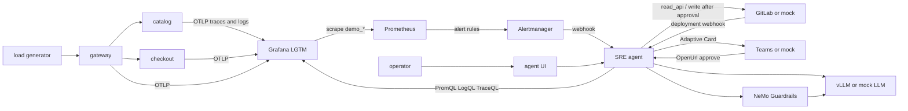

# Agentic SRE for Day-2 operations

See the sections below. This file is the operator guide for the demo in English and Thai.

## English

A local Day-2 prototype. Three small shop services emit traces, metrics, and logs. Prometheus fires through Alertmanager into a LangGraph agent. The agent investigates with read-only tools, posts a Microsoft Teams Adaptive Card, and waits for a person before it opens a GitLab revert merge request or clears a fault.

The default path uses a deterministic mock LLM, a mock GitLab, and a mock Teams webhook, so the demo runs without a GPU. Grafana, Loki, Tempo, Prometheus, and the OpenTelemetry Collector come from the `grafana/otel-lgtm` image.

### Architecture



### What the three scenarios do

The running processes stay up. `/admin/failmode` turns a fault on and off. Scenario 1 is correlated with a real commit, tag, and deployment in the GitLab project: the catalog log cites that SHA, and the agent proposes a revert merge request. Clearing fail mode is the reversible mitigation. The merge request is the code rollback. The two are separate runbook steps, and each write waits for approval.

| # | Fault | Inject | Reset |
| --- | --- | --- | --- |
| 1 | Bad catalog deploy, HTTP 500 `NullPrice` | `scripts/scenario1_inject.sh` | `scripts/scenario1_reset.sh` |
| 2 | Memory leak gauge on catalog | `scripts/scenario2_inject.sh` | `scripts/scenario2_reset.sh` |
| 3 | Checkout orders-db latency | `scripts/scenario3_inject.sh` | `scripts/scenario3_reset.sh` |

### Setup

From `apps/agentic-sre`:

```bash
cp .env.example .env
docker compose --profile mock up --build
```

Then open:

- Agent UI: http://localhost:8080
- Grafana (anonymous admin on this demo, or `admin` / `admin`): http://localhost:3000
- Mock Teams channel: http://localhost:8090
- Mock GitLab project: http://localhost:8929/shop/day2-demo
- Shop gateway: http://localhost:8001/api/products

`uv run pytest` runs the critical tests on the host. It does not need Docker.

Environment variables in `.env.example`:

| Name | Role |
| --- | --- |
| `TEAMS_WEBHOOK_URL` | Workflows incoming webhook. Default is the mock receiver. |
| `GITLAB_URL` | API base. Default `http://mock-gitlab:8929`. Set an internal GitLab URL to swap the mock out. |
| `GITLAB_READ_TOKEN` | `read_api` token. Used for commits, merge requests, pipelines, deployments. |
| `GITLAB_WRITE_TOKEN` | Separate token. Used only to open the revert merge request after approval. |
| `GITLAB_PUBLIC_URL` | Browser links inside cards and the UI. |
| `LLM_BASE_URL` / `LLM_MODEL` | OpenAI-compatible API. Default is the mock. |
| `VLLM_MODEL` | GPU profile model. Default `Qwen/Qwen3-14B-AWQ`. |
| `ADMIN_TOKEN` | Header `X-Admin-Token` for `/admin/failmode`. |

### Mock mode and GPU mode

Mock mode (`--profile mock`) starts `mock-llm` and `mock-gitlab`. No GPU. The mock LLM returns a fixed tool sequence per alert name, then a hypothesis that cites evidence ids.

GPU mode:

```bash
# .env: LLM_BASE_URL=http://vllm:8000/v1
#       LLM_MODEL=Qwen/Qwen3-14B-AWQ
docker compose --profile gpu --profile mock up --build
```

Stop the mock LLM first if both would bind port 8000, or run GPU without the `mock` profile and with `COMPOSE_PROFILES=gpu` plus a GitLab URL. vLLM is started as:

```text
--model $VLLM_MODEL
--quantization awq
--enable-auto-tool-choice
--tool-call-parser hermes
--max-model-len 8192
```

For a 16GB GPU set `VLLM_MODEL=Qwen/Qwen2.5-7B-Instruct-AWQ` and the same `LLM_MODEL`. A 24GB GPU is the assumption for `Qwen/Qwen3-14B-AWQ`.

NeMo Guardrails uses `engine: openai` and `parameters.base_url` pointed at `LLM_BASE_URL`. Input rails mask secrets and run a self-check. Output rails run a self-check. The execution rail is an allowlist (`guardrails/allowlist.yml`) plus a hard block on write tools that have no approval record. The default is read-only. NeMo's tool-call validation flow is enabled in `guardrails/nemo`.

### GitLab CE

The `gitlab` profile runs GitLab CE. It wants about 4GB of RAM and several minutes to boot. Do not publish it on the same host port as the mock. Typical switch:

```bash
docker compose --profile gitlab up -d gitlab
# wait until http://localhost:8929/users/sign_in responds
scripts/bootstrap_gitlab_ce.sh
# .env: GITLAB_URL=http://gitlab:8929 and the printed tokens
```

`scripts/seed_gitlab.py` creates the private `shop/day2-demo` project, the bad catalog commit, the tag `catalog-v1.4.2`, a pipeline, a production deployment, and a webhook. The mock already contains that seed; the script is idempotent against the mock too.

This validation environment did not start GitLab CE. The mock implements the REST endpoints the agent calls. Say so when you rely on this checkout's test notes.

### Resources

- GitLab CE: plan on 4GB+ RAM and a large image pull.
- `grafana/otel-lgtm`: about 1–2GB of RAM once Prometheus, Loki, Tempo, and Grafana are up.
- The Python services are small. The mock LLM is a few tens of megabytes.
- vLLM with the 14B AWQ model needs a 24GB GPU and a lot of disk for the weights. It is not started in mock mode.

### Demo script (about 6 minutes)

1. Open Grafana. The Day-2 dashboard should show steady traffic from the load generator and almost no 5xx.
2. Open the agent UI and the mock Teams channel so you can see them update.
3. Run `scripts/scenario1_inject.sh`. Catalog `/products` starts returning 500. The script also sends a GitLab deployment webhook.
4. Within about a minute Prometheus alert `CatalogHighErrorRate` fires. Alertmanager posts to the agent. The UI shows a new incident, then evidence: a PromQL 5xx rate, an error log that includes `trace_id` and the bad SHA, a Tempo trace, and the `catalog-v1.4.2` deployment.
5. The KPI strip fills in: time to first hypothesis, time to root cause, evidence count, and writes blocked. The blocked count ticks when the agent tries the revert before you approve.
6. The mock Teams channel shows an Adaptive Card with the hypothesis, the queries, the SHA, and Approve / Reject links.
7. Click Approve for the revert merge request. The mock GitLab project gains `revert-catalog-v1.4.2`.
8. Approve clearing fail mode. Catalog returns 200 again. The agent verifies the 5xx rate and posts a postmortem draft to Teams.
9. Optional: `scripts/scenario1_reset.sh` if you rejected the mitigation. Scenarios 2 and 3 use the other inject scripts.

### Tests

```bash
uv run pytest
```

Covers runbook matching, the execution rail blocking unapproved writes, the Teams card shape, the GitLab client against the mock, fail-mode reset, and a full scenario 1 run on the mock LLM.

### Roadmap

- A real Microsoft Bot Framework bot, so Approve / Reject are card actions instead of `Action.OpenUrl`.
- Grafana MCP for PromQL, LogQL, and TraceQL instead of the hand-written clients.
- The OpenTelemetry Demo as the target system in place of the three shop services.

## ภาษาไทย

ต้นแบบ Day-2 สำหรับเครื่องเดียว บริการร้านค้าสามตัวส่ง trace, metric และ log ไปที่ Grafana LGTM Prometheus ยิงแจ้งเตือนผ่าน Alertmanager เข้าเอเจนต์ LangGraph เอเจนต์สืบสวนด้วยเครื่องมืออ่านอย่างเดียว ส่ง Adaptive Card ไปที่ Microsoft Teams และรอคนอนุมัติก่อนเปิด merge request เพื่อ revert ใน GitLab หรือก่อนปิด fault

ค่าเริ่มต้นใช้ mock LLM, mock GitLab และ mock webhook ของ Teams จึงรันได้โดยไม่ต้องมี GPU

### สถาปัตยกรรม

แผนภาพ mermaid ในส่วนภาษาอังกฤษคือสถาปัตยกรรมชุดเดียวกัน: load generator → gateway → catalog และ checkout → OTLP เข้า Grafana LGTM → กฎของ Prometheus → Alertmanager → เอเจนต์ เอเจนต์อ่าน PromQL, LogQL, TraceQL และ GitLab และส่งการ์ดไปที่ Teams ปุ่ม Approve / Reject เป็นลิงก์กลับมาที่หน้าอนุมัติของเอเจนต์ NeMo Guardrails ตรวจอินพุต เอาต์พุต และรายการเครื่องมือ โดยชี้ `base_url` ไปที่ vLLM หรือ mock

### เหตุการณ์ที่ซ้อมได้

`/admin/failmode` เปิดและปิด fault ได้โดยไม่ต้องรีสตาร์ตคอนเทนเนอร์ กรณีที่ 1 ผูกกับ commit, tag `catalog-v1.4.2` และ deployment ใน GitLab log ของ catalog อ้าง SHA นั้น เอเจนต์เสนอ merge request เพื่อ revert การปิด fail mode คือการบรรเทาที่ย้อนกลับได้ทันที ส่วน merge request คือการถอยโค้ด ทั้งสองขั้นต้องได้รับการอนุมัติแยกกัน

| # | อาการ | เปิด | ปิด |
| --- | --- | --- | --- |
| 1 | deploy เสียของ catalog ตอบ 500 `NullPrice` | `scripts/scenario1_inject.sh` | `scripts/scenario1_reset.sh` |
| 2 | memory leak ที่ catalog | `scripts/scenario2_inject.sh` | `scripts/scenario2_reset.sh` |
| 3 | orders-db ของ checkout ช้า | `scripts/scenario3_inject.sh` | `scripts/scenario3_reset.sh` |

### การติดตั้ง

ในโฟลเดอร์ `apps/agentic-sre`:

```bash
cp .env.example .env
docker compose --profile mock up --build
```

เปิด http://localhost:8080 (เอเจนต์), http://localhost:3000 (Grafana), http://localhost:8090 (Teams จำลอง), http://localhost:8929/shop/day2-demo (GitLab จำลอง)

ตัวแปรสำคัญใน `.env.example`:

- `TEAMS_WEBHOOK_URL` — webhook ของ Teams Workflows ค่าเริ่มต้นคือตัวรับจำลอง
- `GITLAB_URL` — ฐานของ API สลับไป GitLab ภายในได้
- `GITLAB_READ_TOKEN` — token สิทธิ์ `read_api` สำหรับ commit, MR, pipeline, deployment
- `GITLAB_WRITE_TOKEN` — token คนละตัว ใช้เปิด MR เพื่อ revert หลังมีคนอนุมัติเท่านั้น
- `VLLM_MODEL` — ค่าเริ่มต้น `Qwen/Qwen3-14B-AWQ` สำหรับ GPU 24GB ถ้า GPU 16GB ให้ใช้ `Qwen/Qwen2.5-7B-Instruct-AWQ`

### โหมด mock กับโหมด GPU

โหมด mock ไม่ใช้ GPU เซิร์ฟเวอร์ mock ตอบลำดับเครื่องมือแบบเดิมทุกครั้งตามชื่อ alert

โหมด GPU ใช้โปรไฟล์ `gpu` และชี้ `LLM_BASE_URL=http://vllm:8000/v1` คำสั่งของ vLLM คือ `--enable-auto-tool-choice --tool-call-parser hermes --max-model-len 8192` พร้อมโมเดล AWQ

NeMo ใช้ engine `openai` และ `base_url` ตาม `LLM_BASE_URL` รางอินพุตมาสก์ข้อมูลลับและทำ self-check รางเอาต์พุตทำ self-check รางปฏิบัติการอนุญาตเฉพาะเครื่องมือใน `guardrails/allowlist.yml` และบล็อกเครื่องมือเขียนถ้ายังไม่มีบันทึกการอนุมัติ ค่าเริ่มต้นคืออ่านอย่างเดียว

### GitLab CE

โปรไฟล์ `gitlab` รัน GitLab CE ต้องใช้แรมประมาณ 4GB ขึ้นไป และใช้เวลาบูตนาน อย่าให้แย่งพอร์ต 8929 กับ mock หลังบูตให้รัน `scripts/bootstrap_gitlab_ce.sh` แล้วตั้ง `GITLAB_URL` กับ token ที่สคริปต์พิมพ์ออกมา `scripts/seed_gitlab.py` สร้างโปรเจกต์ส่วนตัว `shop/day2-demo`, commit ที่ทำให้ catalog พัง, tag, pipeline, deployment และ webhook

สภาพแวดล้อมที่ใช้ตรวจชุดนี้ไม่ได้สตาร์ต GitLab CE เพราะแรมไม่พอสำหรับอิมเมจนั้นร่วมกับ Grafana LGTM mock ตอบ REST API ชุดที่เอเจนต์ใช้แทน

### ทรัพยากร

- GitLab CE: เตรียมแรม 4GB ขึ้นไป และพื้นที่สำหรับอิมเมจขนาดใหญ่
- `grafana/otel-lgtm`: ประมาณ 1–2GB เมื่อ Prometheus, Loki, Tempo และ Grafana ทำงานพร้อมกัน
- บริการ Python และ mock LLM ใช้ทรัพยากรน้อย
- vLLM รุ่น 14B AWQ ต้องการ GPU 24GB โหมด mock ไม่ได้ดึงอิมเมจนี้

### สคริปต์เดโมประมาณ 6 นาที

1. เปิดแดชบอร์ด Day-2 ใน Grafana ควรเห็นทราฟฟิกจาก load generator และแทบไม่มี 5xx
2. เปิด UI ของเอเจนต์และช่อง Teams จำลอง
3. รัน `scripts/scenario1_inject.sh` catalog จะตอบ 500 และสคริปต์ส่ง webhook ของ deployment
4. ภายในประมาณหนึ่งนาที alert `CatalogHighErrorRate` จะเข้าเอเจนต์ UI แสดงหลักฐาน PromQL, บรรทัด log ที่มี `trace_id` และ SHA, trace จาก Tempo และ deployment `catalog-v1.4.2`
5. แถบ KPI แสดงเวลาถึงสมมติฐานแรก เวลาถึงสาเหตุ จำนวนหลักฐาน และจำนวนการเขียนที่ถูกบล็อกระหว่างรออนุมัติ
6. ช่อง Teams แสดงการ์ดพร้อมสมมติฐาน คำค้น ลิงก์ และปุ่ม Approve / Reject
7. กด Approve เพื่อเปิด merge request จากนั้น Approve อีกครั้งเพื่อปิด fail mode
8. เอเจนต์ตรวจว่าอัตรา 5xx ลดลง แล้วส่งร่าง postmortem ไปที่ Teams
9. ถ้าปฏิเสธการบรรเทา ให้รัน `scripts/scenario1_reset.sh` กรณีที่ 2 และ 3 ใช้สคริปต์ inject คู่ของมัน

### การทดสอบ

```bash
uv run pytest
```

ครอบคลุมการจับคู่ runbook, การบล็อกการเขียนที่ยังไม่อนุมัติ, รูปแบบการ์ด Teams, ไคลเอนต์ GitLab กับ mock, การรีเซ็ต fail mode และกรณีที่ 1 แบบ end-to-end กับ mock LLM

### แผนถัดไป

- บอท Microsoft Bot Framework จริง ให้ปุ่ม Approve / Reject เป็น action ของการ์ด ไม่ใช่แค่ `Action.OpenUrl`
- Grafana MCP แทนไคลเอนต์ PromQL, LogQL และ TraceQL ที่เขียนเอง
- ใช้ OpenTelemetry Demo เป็นระบบเป้าหมายแทนบริการร้านค้าสามตัว
